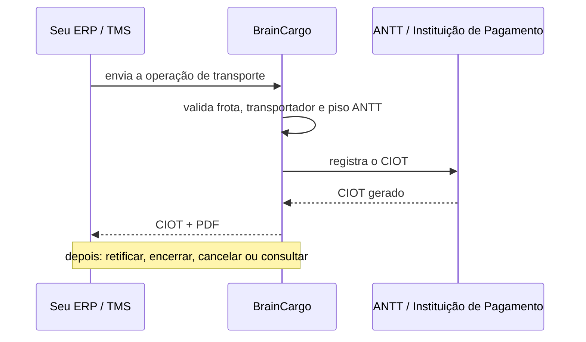

  

<h1 align="center">BrainCargo</h1>

Software na nuvem para transportadoras, armazéns e pátios brasileiros. 
CT-e, MDF-e, NF-e e CIOT no mesmo fluxo, com o piso ANTT conferido antes do envio.

  <a href="https://braincargo.com.br">Site</a> ·
  <a href="https://braincargo.com.br/modulos/">Módulos</a> ·
  <a href="https://braincargo.com.br/precos/">Preços</a> ·
  <a href="https://braincargo.com.br/central-de-ajuda/">Central de Ajuda</a> ·
  <a href="https://www.linkedin.com/company/braincargobr/">LinkedIn</a>

---

## O que fazemos

| Área | Módulos |
|---|---|
| **Fiscal** | [Emissor de CT-e](https://braincargo.com.br/emissor-de-cte/) · [MDF-e](https://braincargo.com.br/emissor-de-mdfe/) · [NF-e](https://braincargo.com.br/emissor-de-nfe/) · [CIOT](https://braincargo.com.br/emissor-de-ciot/) · [API de CIOT](https://braincargo.com.br/api-ciot/) |
| **Operação** | [Comprovação de entrega](https://braincargo.com.br/comprovacao-de-entrega/) · [Roteirização](https://braincargo.com.br/roteirizacao-de-entregas/) · [Sequenciamento](https://braincargo.com.br/sequenciamento-de-cargas/) · [Escala de motoristas](https://braincargo.com.br/escala-de-motoristas/) · [App do motorista](https://braincargo.com.br/app-do-motorista/) |
| **Armazém** | [WMS para operador logístico](https://braincargo.com.br/gestao-de-armazem/) · [Cross dock](https://braincargo.com.br/cross-dock/) |
| **Gestão** | [Frota](https://braincargo.com.br/gestao-de-frota/) · [Financeiro](https://braincargo.com.br/financeiro/) · [Chatbot de WhatsApp](https://braincargo.com.br/chatbot-whatsapp/) |

## Ferramentas grátis

- [Calculadora de frete ANTT](https://braincargo.com.br/calculadora-frete-antt/)
- [Calculadora de cubagem](https://braincargo.com.br/calculadora-cubagem/)
- [Consulta de CIOT](https://braincargo.com.br/consulta-ciot/) · [CT-e](https://braincargo.com.br/consulta-cte/) · [RNTRC](https://braincargo.com.br/consulta-rntrc/)

## Integração

Quem tem ERP ou TMS próprio pode emitir e gerir o CIOT por API, sem redigitar a viagem. O fluxo, em alto nível:

- Autenticação por token, separado por ambiente (homologação e produção).
- A documentação técnica é liberada com a conta. Fale com a equipe pelo [site](https://braincargo.com.br/api-ciot/).

---

BrainCargo é uma marca da Brain Software & Intelligence LTDA · São Paulo/SP e Fortaleza/CE · Equipe BrainCargo
